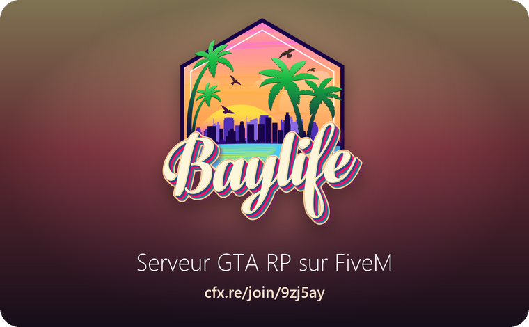
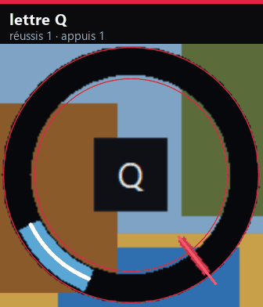
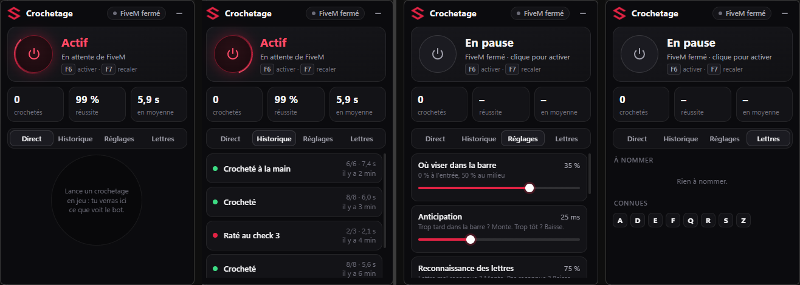
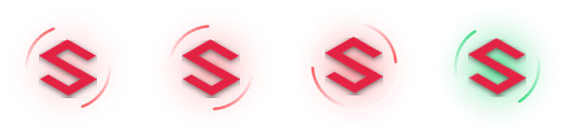
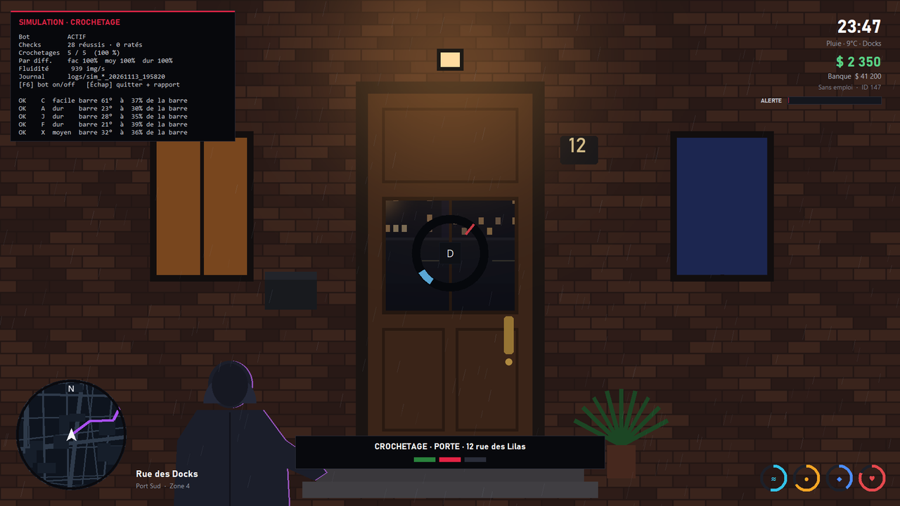
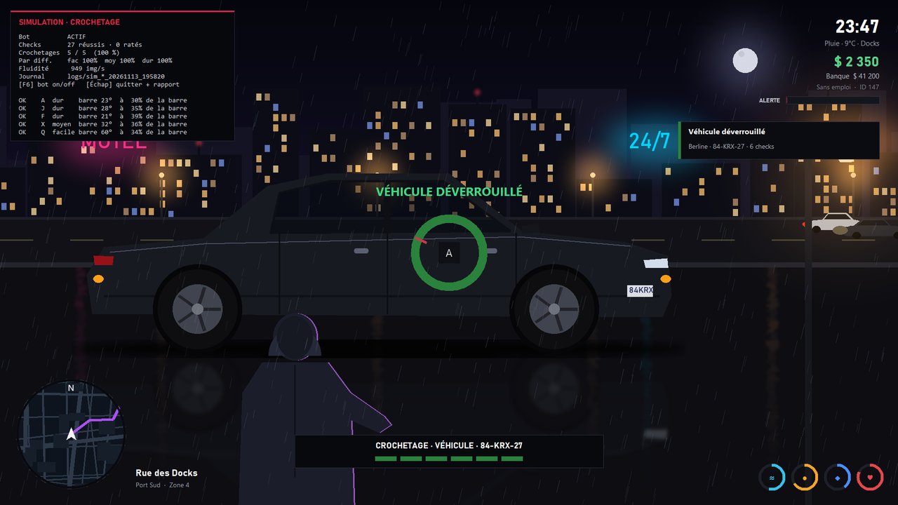
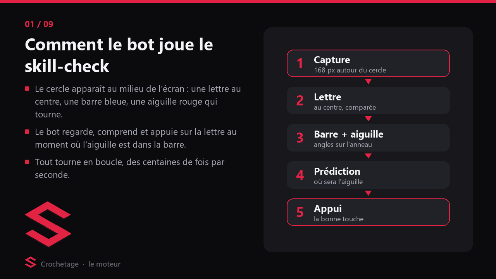
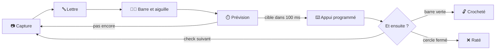

<p align="center">
  
</p>

<p align="center">
  
  
  
  
  <a href="LICENSE"></a>
</p>

**Crochetage** joue tout seul le mini-jeu de crochetage du serveur **Baylife** sur FiveM : portes, véhicules,
siphon. Il lit l'anneau au centre de l'écran, reconnaît la lettre, suit l'aiguille et appuie au bon moment,
check après check, jusqu'à la barre verte.

> [!NOTE]
> **Fait uniquement pour Baylife.** L'anneau, les lettres et les couleurs sont calés sur ce serveur, et le bot
> vérifie que tu y es connecté avant chaque appui : ailleurs, il reste en veille.

<p align="center">
  <a href="https://cfx.re/join/9zj5ay"></a>
  <br>
  <a href="https://cfx.re/join/9zj5ay"></a>
</p>

<p align="center">
  <sub>Adresse : <code>cfx.re/join/9zj5ay</code> · serveur <code>gta.bay.life</code> · dans la console F8 de FiveM : <code>connect cfx.re/join/9zj5ay</code></sub>
  <br>
  <sub>Projet indépendant, sans lien avec l'équipe de Baylife.</sub>
</p>

<table>
  <tr>
    <td align="center"><br><sub><b>En jeu</b> : l'overlay autour de l'anneau</sub></td>
    <td align="center"><br><sub><b>L'appli</b>, en bas à droite de l'écran</sub></td>
  </tr>
</table>

> [!WARNING]
> Sur la plupart des serveurs FiveM, les macros et l'automatisation sont interdites par le règlement.
> À utiliser à tes risques, ban possible.

## Sommaire

| | |
|---|---|
| 🚀 [Démarrer](#-démarrer) | installer, lancer, les trois touches |
| 💻 [L'appli](#-lappli) | la fenêtre et ses onglets |
| 🎯 [En jeu](#-en-jeu) | overlay, logo animé, bruitages |
| 🔧 [Réglages et dépannage](#-réglages-et-dépannage) | quoi régler, quoi faire si ça rate |
| 🧪 [Simulation](#-simulation) | s'entraîner sans le jeu |
| 🧠 [Sous le capot](#-sous-le-capot) | comment le moteur décide, et les résultats des tests |
| 📁 [Fichiers](#-fichiers) | qui fait quoi dans le projet |
| 📜 [Licence](#-licence) | installer et utiliser, sans modifier |

---

## 🚀 Démarrer

**Installer**
1. Installe [Python 3.12+](https://www.python.org/downloads/) en cochant « Add Python to PATH ».
2. Télécharge ce dépôt, bouton **Code → Download ZIP**, et décompresse-le.
3. Double-clic sur **`0_installer.bat`** : il installe les dépendances et crée le lanceur **Crochetage** sur
   le Bureau et dans le menu Démarrer.
4. Pour la barre des tâches : clic droit sur le raccourci du Bureau, **Afficher d'autres options**,
   **Épingler à la barre des tâches**.

**Jouer**
1. Clique sur le lanceur **Crochetage** : l'appli s'ouvre en bas à droite et son logo apparaît près de l'horloge.
2. Mets FiveM en **fenêtré sans bordure** et connecte-toi à **Baylife**.
3. Appuie sur **F6**. C'est tout : l'anneau est trouvé tout seul au centre de l'écran, et les lettres
   A, Z, E, R, Q, S, D et F sont déjà connues.

| Touche | Action |
|---|---|
| **F6** | activer ou mettre en pause |
| **F7** | recaler l'anneau, pendant un crochetage |
| **F8** | apprendre la lettre affichée, puis appuie sur cette lettre |

---

## 💻 L'appli

<p align="center"></p>

Une petite fenêtre de 320 × 470, en HTML et CSS dans une vue Edge : texte et coins nets, animations fluides.

- **Le gros bouton** active ou met en pause le bot, comme F6. Il s'allume en rouge quand le moteur tourne.
- **La pastille** en haut indique **Baylife**, **Autre serveur** ou **FiveM fermé**.
- **Trois chiffres** : crochetages réussis, taux de checks réussis, durée moyenne d'un crochetage.

| Onglet | Ce qu'il montre |
|---|---|
| **Direct** | ce que voit le bot sur l'anneau, avec la barre, l'aiguille et le point d'appui |
| **Historique** | les derniers crochetages, leurs checks, leur durée |
| **Réglages** | où viser, anticipation, reconnaissance, bruitages, overlay, logo, démarrage avec Windows |
| **Lettres** | les lettres à nommer, et celles déjà connues |

La fenêtre se cache quand tu cliques ailleurs. Pour la rouvrir : le logo près de l'horloge, ou le lanceur.
Clic droit sur le logo : Activer, Détecter, Simulation, Bruitages, Quitter.

---

## 🎯 En jeu

**L'overlay sur l'anneau** se pose sur une fine piste juste autour de l'anneau du jeu, sans rien cacher.

<p align="center"></p>

| Repère | Ce que c'est |
|---|---|
| arc cyan | la barre lue par le bot |
| point rouge | l'aiguille, en direct |
| point blanc | l'endroit exact où partira l'appui |
| piste verte ou rouge | crocheté ou raté |

**Le logo animé** flotte en bas à gauche de l'écran tant que le bot est actif sur Baylife : deux arcs tournent
autour, plus vite pendant un crochetage, une onde part à chaque appui, et tout passe au vert quand c'est crocheté.

<p align="center"></p>

**Les bruitages**, synthétisés par le code, sans fichier audio récupéré ailleurs :

| Moment | Son |
|---|---|
| chaque appui | le clic sec d'une goupille, un peu plus aigu à chaque check |
| crocheté | une serrure qui cède, puis un petit arpège |
| raté | la crochette qui casse |

L'overlay et le logo laissent passer les clics, ne prennent jamais le focus et restent **invisibles pour
les captures d'écran** : le bot ne voit pas ses propres traits, et rien n'apparaît dans tes enregistrements.

---

## 🔧 Réglages et dépannage

| Réglage dans l'appli | Quand y toucher |
|---|---|
| **Où viser dans la barre** | 0 % à l'entrée de la barre, 50 % au milieu. 35 % par défaut. |
| **Anticipation** | Appuie trop tard dans la barre ? Monte. Trop tôt ? Baisse. Le rapport donne la bonne valeur. |
| **Reconnaissance des lettres** | Mauvaise lettre ? Monte. Lettre pas reconnue ? Baisse. |
| **Bruitages, overlay, logo animé** | Pour les couper. |
| **Fenêtre du jeu** | Texte que doit contenir le titre du jeu, « FiveM » par défaut. |

<details>
<summary><b>Tous les réglages de <code>config.json</code></b></summary>
<br>

| Clé | Par défaut | Rôle |
|---|---|---|
| `serveur_cible` | `bay.life` | serveur autorisé, vide pour tous |
| `zone_jeu` | oui | se caler tout seul sur l'anneau de Baylife |
| `appui_ms` | 50 | durée de l'appui ; le jeu tourne parfois à 30 images/s |
| `sons`, `volume_sons` | oui, 0,7 | bruitages et leur volume, de 0 à 1 |
| `overlay`, `logo_anime` | oui | overlay sur l'anneau, logo animé |
| `logo_position` | `gauche` | `gauche` ou `droite` en bas de l'écran |
| `capture` | `auto` | `dxgi`, `mss` ou automatique |
| `journal`, `captures_echec` | oui | journal détaillé, images des ratés |

</details>

**Si ça ne marche pas**
- **« PAS envoyé : serveur … »** : tu n'es pas sur Baylife, ou FiveM n'a pas encore noté le serveur.
- **« PAS envoyé : fenêtre active … »** : le jeu n'était pas devant.
- **Touche ignorée par le jeu** : lance l'appli en administrateur.
- **Lettre inconnue** : joue-la une fois toi-même, ou nomme-la dans l'onglet Lettres.
- **Des ratés ?** Lance `python rapport.py --jeu`, puis regarde les images dans `logs/captures/`.

---

## 🧪 Simulation

**`2_Simulation.bat`** ouvre un crochetage d'entraînement en plein écran, façon serveur RP : de nuit, sous la
pluie, tu voles une berline ou tu crochètes une porte. Le mini-jeu reprend les tailles et les couleurs du
vrai. **F6** active ou coupe le bot, **Échap** quitte, et le rapport est généré à la fermeture.

<p align="center"></p>

<details>
<summary><b>Options de la simulation</b></summary>
<br>

```bash
python simulation.py --scene porte           # vehicule, porte ou mix
python simulation.py --vitesse 1.5           # aiguille 1,5 fois plus rapide
python simulation.py --sans-bot              # pour jouer toi-même
python simulation.py --duree 300             # s'arrête tout seul après 5 min
python simulation.py --meme-check 0.3        # 30 % des checks reprennent la lettre et la barre du précédent
python simulation.py --barres-tardives 0.3   # 30 % des barres en fin de tour
python simulation.py --sans-overlay          # sans l'overlay
```

| | |
|---|---|
|  |  |
| <sub>Crochetage d'une porte</sub> | <sub>Fin du cycle : la barre passe au vert</sub> |

</details>

---

## 🧠 Sous le capot

Le cœur du bot en 9 diapos, toutes tirées des vrais calculs du moteur :

<p align="center"></p>



<details>
<summary><b>📷 Capture</b> : DXGI, 0,27 ms par image</summary>
<br>

Capture par DXGI Desktop Duplication avec `dxcam`, et repli automatique sur `mss` si DXGI n'est pas
disponible. Sur la zone de 169 px :

| | mss | DXGI |
|---|---|---|
| Temps d'une capture | 6,0 ms | **0,27 ms** |
| Nouvelle image du jeu | vue jusqu'à ~7 ms plus tard | analysée dès qu'elle est affichée |

</details>

<details>
<summary><b>🎯 Trouver l'anneau</b> : zone de base, contrôle de l'anneau noir</summary>
<br>

Sur Baylife, l'anneau s'ouvre toujours au centre de l'écran, avec un rayon de **82 px en 1080p**,
proportionnel à la hauteur de l'écran. Le bot s'y place dès le démarrage. Une zone enregistrée qui ne colle
pas à l'anneau du jeu est remplacée automatiquement.

**F7** recale la zone pendant un crochetage. Le bot garde le rouge qui bouge, en fait des traits qui pointent
vers le centre, et cherche par vote RANSAC le point où ils se croisent. Un cercle n'est retenu que si son rayon
est proche de celui du jeu et que l'**anneau noir couvre au moins 75 % du tour**. Le centre est ensuite affiné
sur les bords nets de l'anneau.

<p align="center"></p>

</details>

<details>
<summary><b>🔤 Lire la lettre</b> : lettres de base, apprentissage</summary>
<br>

Le carré du centre est comparé aux lettres connues avec `cv2.matchTemplate`. La meilleure gagne si elle
dépasse **75 %**.

`lettres_base/` contient A, Z, E, R, Q, S, D et F dessinées dans une police très proche de celle de Baylife.
Sur les vraies lettres du jeu, elles donnent A 0,965, Z 0,926, E 0,889 et R 0,94. Une lettre hors de cette
liste reste inconnue : le bot ne la joue pas, garde son image, et l'apprend si tu la joues toi-même, avec F8,
ou dans l'onglet Lettres. Il n'apprend que si FiveM est devant et que tu es sur Baylife.

</details>

<details>
<summary><b>🔵🔴 La barre et l'aiguille</b> : masques HSV sur l'anneau</summary>
<br>

Masques de couleur HSV, bleu pour la barre, rouge pour l'aiguille, vert pour la fin, **seulement sur
l'anneau**. Chaque pixel devient un angle, rangé par cases de 2°. La barre est le bloc bleu le plus épais,
l'aiguille le bloc rouge le plus épais : un liseré de décor de 1 ou 2 pixels est écarté.

</details>

<details>
<summary><b>⏱️ Prévoir et appuyer</b> : Theil-Sen, appui programmé</summary>
<br>

La vitesse de l'aiguille sort d'une régression robuste de Theil-Sen sur les 300 dernières millisecondes :
une image mal lue ne la fausse pas. La position prévue tient compte de la latence :

```
position prévue = position ajustée maintenant + vitesse × latence
```

**Appui programmé** : dès que l'aiguille doit atteindre **35 % de la barre** dans les 100 ms, le bot calcule
l'instant exact et confie l'appui à un fil qui part à cette milliseconde. La lecture des images continue, et
une baisse d'images ou un coup de lag ne le font plus sauter par-dessus la barre. Juste avant d'appuyer, il
revérifie que FiveM est devant.

La touche part avec `SendInput` en scancode, clavier AZERTY compris. Un verrou garantit **un seul appui par
check**.

</details>

<details>
<summary><b>✅ Savoir si c'est réussi</b> : check suivant, barre verte</summary>
<br>

| Ce qu'il voit après un appui | Ce qu'il en conclut |
|---|---|
| le check suivant apparaît, ou la lettre change | check réussi |
| la barre passe au vert `#2A823C`, puis le cercle se ferme | crocheté |
| le cercle disparaît sans vert | raté |

</details>

<details>
<summary><b>🔒 Seulement sur Baylife</b> : serveur et fenêtre vérifiés</summary>
<br>

Le bot n'appuie que si **FiveM est au premier plan** et que tu es connecté à **Baylife**. FiveM note le
dernier serveur rejoint dans `%LOCALAPPDATA%\FiveM\FiveM.app\data\cache\crashometry`, que le bot relit avant
chaque appui. Ailleurs, il reste en veille.

</details>

<details>
<summary><b>📜 Journal et rapport</b> : tout est noté, de A à Z</summary>
<br>

| Fichier dans `logs/` | Contenu |
|---|---|
| `moteur_<date>.jsonl` | en jeu : chaque crochetage, chaque check, chaque appui |
| `sim_verite_<date>.jsonl` | en simulation : ce qui s'est vraiment passé, au degré près |
| `sim_moteur_<date>.jsonl` | en simulation : ce que le bot a vu et décidé |
| `captures/` | les images de chaque check raté |
| `rapport_<date>.md` | le rapport d'analyse |

```bash
python rapport.py          # dernière session
python rapport.py --jeu    # dernière session en jeu
```

Le rapport donne les résultats, la précision des appuis, le calage entre prévu et réel, et les réglages à
changer.

</details>

### Résultats des tests

| Test | Résultat |
|---|---|
| En jeu sur Baylife, siphon d'essence | **4 / 4** crochetages, **32 / 32** checks |
| Simulation de 4 min, véhicules et portes | **49 / 49** crochetages, **226 / 226** checks |
| Rejeu hors ligne des 19 sessions enregistrées | **2 380 / 2 380** checks |
| Rejeu à 30 images/s avec un coup de lag toutes les 2 s | 95,8 % avant l'appui programmé, **98,8 %** après |
| Rejeu de la simulation à 15 images/s | 69,8 % avant, **98,1 %** après |
| Où tombe l'appui dans la barre, cible 35 % | **33 % ± 3 %** |
| Écart entre l'appui prévu et l'appui réel | **0,9 ms** d'écart-type |
| Détection de l'anneau sur 26 scènes, leurres compris | centre à **0 px** en médiane, **1,6 px** au pire |

---

## 📁 Fichiers

| Fichier | Rôle |
|---|---|
| [`Crochetage.pyw`](Crochetage.pyw) | l'appli : icône près de l'horloge, fenêtre, overlays |
| [`interface/index.html`](interface/index.html) | l'interface de l'appli |
| [`autotouche.py`](autotouche.py) | le moteur : détection, lecture, décision, clavier, journal |
| [`overlay.py`](overlay.py) | l'overlay sur l'anneau et le logo animé |
| [`sons.py`](sons.py) | les bruitages |
| [`simulation.py`](simulation.py), [`scene.py`](scene.py) | la simulation et ses décors |
| [`rapport.py`](rapport.py) | le rapport d'analyse des journaux |
| [`lettres_base/`](lettres_base) | les lettres de base |
| [`raccourcis.py`](raccourcis.py) | l'icône et le lanceur |
| `config.json`, `templates/`, `logs/` | tes réglages, tes lettres, tes journaux, créés au premier lancement |

En ligne de commande : `python autotouche.py --test capture.png` teste la détection sur une capture.

---

## 📜 Licence

© 2026 ninoelhaj, tous droits réservés. Tu peux installer et utiliser Crochetage gratuitement, et régler tout
ce que l'appli propose, `config.json` compris. Tu ne peux pas modifier le code, le reprendre dans un autre projet,
le redistribuer ni le vendre. Un bug ou une idée : ouvre une issue. Tout est dans [LICENSE](LICENSE).

---

<p align="center">
  <sub>Du même auteur : <a href="https://github.com/ninoelhaj/paperasse"><b>Paperasse</b></a>, tes papiers rangés et expliqués · <a href="https://github.com/ninoelhaj">profil</a></sub>
</p>
