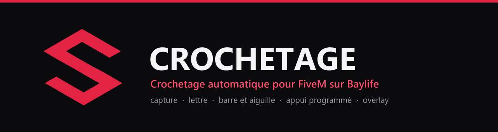
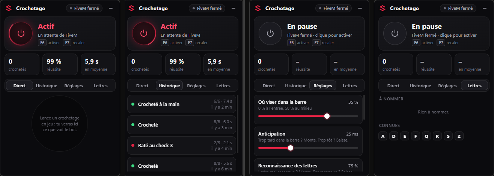
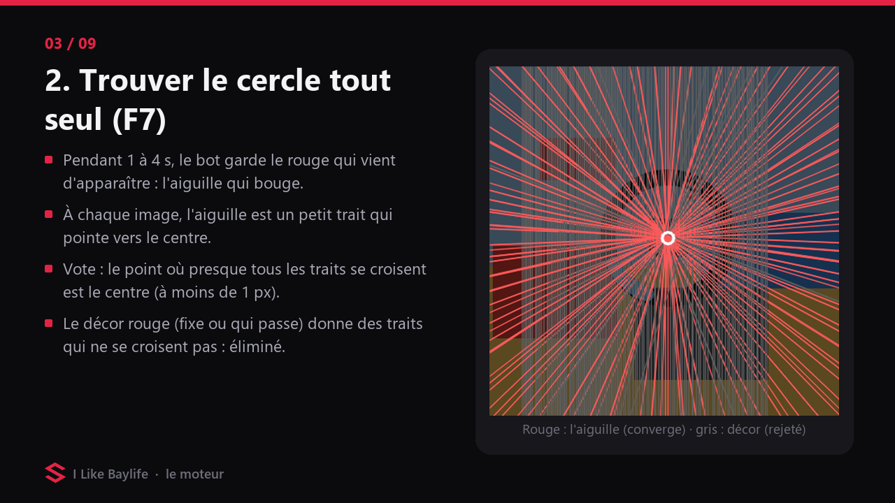
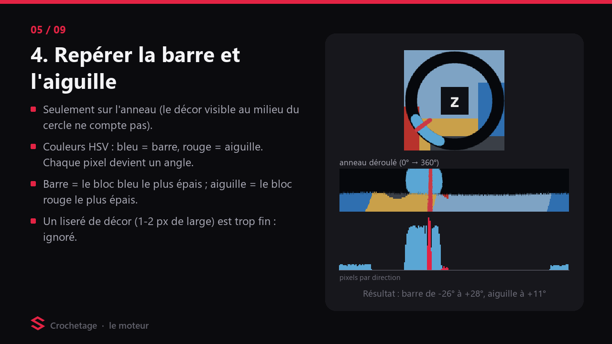
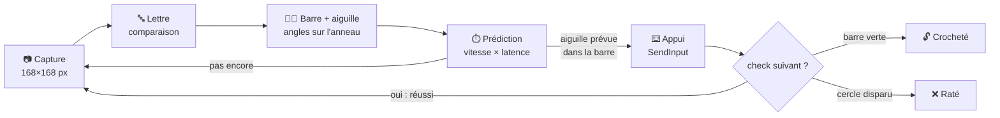
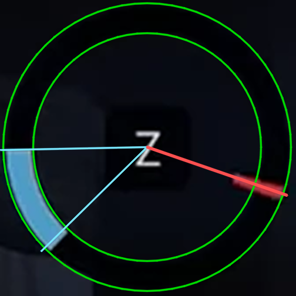
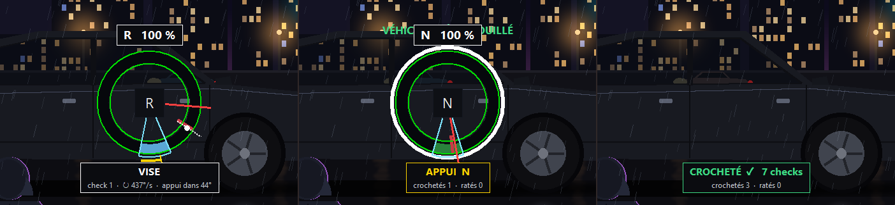
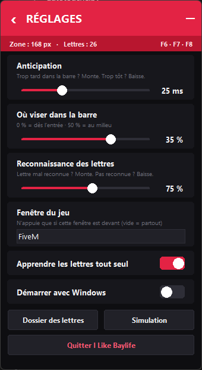

<p align="center">
  
</p>

<p align="center">
  
  
  
  
</p>

**Crochetage** joue tout seul le mini-jeu de crochetage de FiveM : portes, véhicules. Un cercle apparaît au
milieu de l'écran avec une lettre au centre, une barre bleue et une aiguille rouge qui tourne. Dès que
l'aiguille arrive dans la barre, l'appli appuie sur la bonne lettre. Elle enchaîne les checks (jusqu'à 6,
barre de taille différente à chaque fois). À la fin, la barre passe au vert et le cercle se ferme : c'est crocheté.

<table>
  <tr>
    <td align="center"><br><sub><b>Le bot en action</b> (ce qu'il voit, en vrai)</sub></td>
    <td align="center"><br><sub><b>L'appli</b>, près de l'horloge</sub></td>
  </tr>
</table>

> [!WARNING]
> Sur la plupart des serveurs FiveM, les macros et l'automatisation sont interdites par le règlement.
> À utiliser à tes risques (ban possible).

---

## Sommaire
- [Le moteur en diaporama](#-le-moteur-en-diaporama)
- [Comment ça marche, en détail](#-comment-ça-marche-en-détail)
- [Journal et rapport](#-journal-et-rapport)
- [Installation](#-installation)
- [Utilisation](#-utilisation)
- [La simulation](#-la-simulation)
- [Réglages et dépannage](#-réglages-et-dépannage)
- [Fichiers du projet](#-fichiers-du-projet)

---

## 🎬 Le moteur en diaporama

Le cœur du bot en 9 diapos (elles défilent toutes seules). Toutes les images viennent des **vrais calculs
du moteur**, faits sur une vraie capture du jeu et sur la simulation.

<p align="center">
  
</p>

<details>
<summary><b>▶ Voir les diapos une par une</b></summary>
<br>

| | |
|---|---|
|  |  |
|  |  |
|  |  |
|  |  |
|  | |

</details>

---

## 🧠 Comment ça marche, en détail

### La boucle



Tout se passe dans [`autotouche.py`](autotouche.py), dans la classe `Moteur`. La boucle tourne en continu :
capture, lecture, décision, et appui si c'est le moment.

**Capture** : par DXGI Desktop Duplication (`dxcam`), avec repli automatique sur `mss` (GDI) si DXGI n'est
pas disponible. Mesuré sur la zone de 168 px :

| | mss (GDI) | DXGI |
|---|---|---|
| Temps d'une capture | 6,0 ms | **0,27 ms** |
| Nouvelle image du jeu | vue au prochain tour, jusqu'à ~7 ms plus tard | analysée dès qu'elle est affichée |
| Décision entre deux images | toutes les ~7 ms | toutes les ~1 ms (l'aiguille est extrapolée) |

Le timing ne change pas d'une capture à l'autre (même `latence_ms`) : en simulation, écart moyen entre
appui prévu et réel de −3,9 ms en DXGI contre −4,3 ms en mss.

### 1. Trouver le cercle (touche F7)
Pas besoin de régler une zone à la souris. Pendant qu'un crochetage tourne, **F7** lance la détection :
1. pendant ~1 s, le bot ne garde que le rouge **qui vient d'apparaître** (l'aiguille qui bouge) ;
2. à chaque image, l'aiguille devient un petit **trait qui pointe vers le centre** (axe principal du bloc
   de pixels, par ACP) ;
3. un **vote** (RANSAC) cherche le point où presque tous les traits se croisent : c'est le centre, à
   moins d'un pixel près. Les traits du décor (une voiture rouge qui passe) ne se croisent pas au même
   endroit : ils sont éliminés ;
4. l'épaisseur de l'anneau vient de la longueur de l'aiguille.

<p align="center">
  <br>
  <sub>Sur une vraie capture du jeu : anneau trouvé (vert), bords de la barre (jaune) et aiguille (rouge).</sub>
</p>

### 2. Lire la lettre
Un petit carré au centre (20 % de la zone, à l'intérieur du carré sombre) est comparé aux lettres
apprises avec `cv2.matchTemplate` (corrélation normalisée). La meilleure gagne si elle dépasse **75 %**.
Les modèles sont un peu plus petits que le carré lu, donc une lettre décalée de quelques pixels est
quand même reconnue.

### 3. La barre et l'aiguille
- Masques de couleur **HSV** (bleu = barre, rouge = aiguille, vert = crocheté), **seulement sur l'anneau** :
  le décor visible au milieu du cercle ne compte pas.
- Chaque pixel devient un **angle**, rangé par cases de 2°.
- **Barre** = le bloc bleu le plus *épais* ; **aiguille** = le bloc rouge le plus épais. Un liseré de
  décor au bord de l'anneau ne fait que 1 ou 2 pixels de large : il est écarté, même quand il couvre un
  grand arc (feu arrière ou gyrophare qui passe juste derrière l'aiguille). Une barre doit remplir au
  moins 35 % de l'épaisseur de l'anneau.

### 4. Prévoir le bon moment
La vitesse de l'aiguille est mesurée en direct, dans les deux sens de rotation. Le bot calcule :

```
position prévue = aiguille + vitesse × (latence + âge de l'image)
```

Il appuie dès que la position prévue atteint **35 % de la barre** (réglable). Ça laisse de la marge
avant et après, même sur les petites barres. Si la vitesse n'est pas encore connue, il attend une
image de plus.

### 5. Appuyer, une seule fois
- La touche part avec `SendInput` en **code de touche** (scancode) : le jeu la reçoit comme une vraie
  frappe, et le clavier AZERTY est géré.
- **Sécurité** : rien n'est envoyé si la fenêtre au premier plan n'est pas « FiveM ». Le bot ne tape
  jamais de lettre dans une autre appli.
- Un **verrou** garantit un seul appui par check. Il se libère quand le check suivant apparaît (nouvelle
  lettre, barre déplacée, aiguille repartie de zéro).

### 6. Savoir si c'est réussi
Dans le jeu, rien ne passe au vert entre deux checks. À la fin, seule la **barre du dernier check** passe au
vert (`#2A823C`), puis le cercle se ferme aussitôt : l'objet est crocheté. Le bot déduit donc l'issue tout
seul :

| Ce qu'il voit après un appui | Ce qu'il en conclut |
|---|---|
| le check suivant apparaît | check réussi |
| la barre passe au vert, puis le cercle se ferme | crocheté (porte, véhicule ouvert) |
| le cercle disparaît sans vert | raté |

Pendant que la barre est verte, le bot n'appuie jamais.

### 7. Seulement sur Baylife
Le bot n'appuie que si **FiveM est au premier plan** et que tu es **connecté à Baylife**
(`fivem://connect/9zj5ay`, `https://gta.bay.life`). FiveM note le dernier serveur rejoint dans
`%LOCALAPPDATA%\FiveM\FiveM.app\data\cache\crashometry` (`last_server_url`) : le bot le relit avant chaque
appui. Sur un autre serveur, il reste en veille et le note dans le journal (« PAS envoyé : serveur … »).
Réglage `serveur_cible` dans `config.json` (`bay.life` par défaut, vide = tous les serveurs).

### 8. L'overlay en jeu, sur l'anneau
Dès que le bot est actif et que FiveM est devant, tout ce que fait le moteur se dessine **en direct sur
l'anneau** ([`overlay.py`](overlay.py)) :

| Couleur | Ce que c'est |
|---|---|
| 🟢 vert | l'anneau où le bot cherche la barre et l'aiguille |
| 🔵 cyan | la barre trouvée (ses deux bords) |
| 🔴 rouge | l'aiguille telle qu'il vient de la mesurer |
| ⚪ pointillés | où sera l'aiguille quand le jeu recevra la touche |
| 🟡 jaune | la fenêtre dans laquelle il appuiera |

En haut, la lettre lue et son score. En bas, l'état (vise, appui, réussi, crocheté, raté, pas envoyé…), le
numéro du check, la vitesse de l'aiguille et l'angle restant avant l'appui. L'anneau flashe en blanc à
l'appui et en vert quand c'est réussi.

<p align="center"></p>

L'overlay ne prend jamais le focus, laisse passer les clics et se cache dès que le bot est en pause ou que
tu quittes le jeu. Il est **invisible pour les captures d'écran** (exclu par Windows) : le bot ne voit donc
pas ses propres traits, et l'overlay n'apparaît pas non plus dans tes captures, tes enregistrements ou tes
streams. Si Windows ne peut pas l'exclure, il n'affiche que les textes autour de l'anneau, jamais dedans.
Réglage `overlay` dans `config.json`. La simulation l'affiche aussi (`--sans-overlay` pour l'enlever).

### 9. Apprendre les lettres
- **Tout seul** : sur une lettre inconnue, tu la joues toi-même. Si le check suivant apparaît (ou si
  la barre passe au vert), le bot enregistre l'image comme modèle.
- Ou **F8** puis la lettre, ou bien en tapant la lettre dans l'appli (« à nommer »).

### Résultats des tests
| Test | Résultat |
|---|---|
| Simulation de vol de véhicule et de porte (trafic, gyrophares, pluie), 4 min | **51 / 51** crochetages, **240 / 240** checks, 0 appui en trop |
| Cas piège : même lettre et même barre deux fois de suite | **45 / 45** checks |
| Où tombe l'appui dans la barre (cible 35 %) | **34 % ± 3 %** |
| Le bot sait-il s'il a réussi ? | d'accord avec la vérité sur **51 / 51** crochetages |
| Détection du cercle sur 200 scènes générées (nuit, voitures bleues/rouges collées) | **192 / 200**, centre à < 1 px |
| Vraie capture du jeu | cercle, barre et aiguille trouvés au pixel près |

---

## 📜 Journal et rapport

Tout est noté, de A à Z, dans le dossier `logs/` (un événement JSON par ligne) :

| Fichier | Contenu |
|---|---|
| `moteur_<date>.jsonl` | en jeu : chaque crochetage, chaque check, chaque appui (position prévue dans la barre, vitesse, âge de l'image), chaque image où la barre a été perdue et pourquoi |
| `sim_verite_<date>.jsonl` | en simulation : ce qui s'est vraiment passé, au degré près (où était l'aiguille quand la touche est arrivée) |
| `sim_moteur_<date>.jsonl` | en simulation : ce que le bot a vu et décidé |
| `captures/` | les images vues par le bot pendant chaque check raté |
| `rapport_<date>.md` | le rapport d'analyse |

```bash
python rapport.py          # dernière session (simulation ou jeu)
python rapport.py --jeu    # dernière session en jeu
```

Le rapport donne les résultats, la précision (histogramme de la position des appuis dans la barre), le
**calage** entre ce que le bot avait prévu et ce qui s'est passé, les pertes de détection, le détail de
chaque raté, et **les réglages à changer** :

```
[rapport] Crochetages 47/47 · checks 221/221
[rapport] Appui à 34 % de la barre en moyenne (± 3 %)
[rapport] Anticipation : la touche arrive en moyenne 4.3 ms plus tôt que prévu → latence_ms 8 → 4.
```

---

## 📦 Installation
1. Installer [Python 3.12+](https://www.python.org/downloads/) (cocher « Add Python to PATH »).
2. Télécharger ce dépôt (bouton **Code → Download ZIP**) et le décompresser.
3. Double-clic sur **`0_installer.bat`** (installe dxcam, mss, OpenCV, numpy, pystray, Pillow).

## 🎮 Utilisation
1. Double-clic sur **`1_Lancer Crochetage.bat`** : le logo apparaît près de l'horloge (sinon, regarde
   dans la flèche `^`). Il est rouge quand le bot est actif, gris en pause.
2. Mets le jeu en **fenêtré sans bordure** (en plein écran exclusif, la capture d'écran sort noire).
3. Lance un crochetage, puis appuie sur **F7** pendant que l'aiguille tourne : « Cercle trouvé ».
4. Appuie sur **F6** pour activer ou mettre en pause.

| Touche | Action |
|---|---|
| **F6** | activer / pause |
| **F7** | trouver le cercle (pendant un crochetage) |
| **F8** | apprendre la lettre affichée (puis appuie sur la lettre) |

Clic sur le logo : ouvre l'appli (aperçu en direct de ce que voit le bot, crochetages réussis, réglages).
Clic droit : Activer, Détecter, Simulation, Quitter.

## 🧪 La simulation
**`2_Simulation.bat`** ouvre un crochetage d'entraînement en **plein écran**, façon serveur RP : de nuit,
sous la pluie, tu voles une berline garée ou tu crochètes une porte d'entrée. Le mini-jeu est copié sur
le vrai (mêmes tailles et couleurs) : 3 à 6 checks d'affilée, barre de taille variable, barre verte à la
fin, puis le cercle se ferme. Autour : trafic dont les feux rouges passent derrière le cercle, patrouilles de police avec
gyrophares rouge / bleu, alarme du véhicule sur un raté, HUD de serveur RP (mini-carte, argent, jauges,
alerte police).

<p align="center"></p>

| | |
|---|---|
|  |  |
| <sub>Crochetage d'une porte</sub> | <sub>Fin du cycle : la barre passe au vert, puis le cercle se ferme</sub> |

Le bot de la simulation trouve le cercle et apprend les lettres tout seul. **F6** = bot ON/OFF (pour
jouer toi-même), **Échap** = quitter ; le rapport est généré à la fermeture.

```bash
python simulation.py --scene porte       # seulement des portes (vehicule / porte / mix)
python simulation.py --vitesse 1.5       # aiguille 1.5x plus rapide
python simulation.py --sans-bot          # pour jouer toi-même
python simulation.py --duree 300         # s'arrête tout seul après 5 min
```

## 🔧 Réglages et dépannage


| Réglage (⚙) | Quand y toucher |
|---|---|
| **Anticipation** | Appuie trop **tard** dans la barre → monte. Trop **tôt** → baisse. Le rapport donne la bonne valeur. |
| **Où viser** | 0 % = dès l'entrée de la barre, 50 % = au milieu. |
| **Reconnaissance** | Mauvaise lettre → monte. Lettre pas reconnue → baisse. |
| **Fenêtre du jeu** | Texte que doit contenir le titre de la fenêtre (par défaut « FiveM »). |
| **Démarrer avec Windows** | Lance l'appli à l'ouverture de session. |

Dans `config.json` : `serveur_cible` (`bay.life` par défaut, vide = tous les serveurs), `overlay` (oui par
défaut), `capture` (`auto` par défaut, `dxgi` ou `mss`), `journal` (journal détaillé, oui par défaut) et
`captures_echec` (images des ratés, oui par défaut).

- **« Cercle pas trouvé »** : refais F7 pendant que l'aiguille tourne.
- **« PAS envoyé : serveur … »** : tu n'es pas connecté à Baylife (ou FiveM n'a pas encore noté le serveur).
- **« PAS envoyé : fenêtre active … »** : le jeu n'était pas devant, ou son titre ne contient pas
  « FiveM ». Corrige « Fenêtre du jeu ».
- **Touche ignorée par le jeu** : lance l'appli en administrateur.
- **Des ratés ?** `python rapport.py --jeu`, puis regarde les images dans `logs/captures/`.

<br clear="right">

## 📁 Fichiers du projet
| Fichier | Rôle |
|---|---|
| [`Crochetage.pyw`](Crochetage.pyw) | l'appli (zone de notification + fenêtre style Mullvad) |
| [`autotouche.py`](autotouche.py) | le moteur : détection, analyse, décision, clavier, journal (utilisable aussi en ligne de commande) |
| [`overlay.py`](overlay.py) | l'overlay dessiné en direct sur l'anneau, en jeu et dans la simulation |
| [`simulation.py`](simulation.py) | la simulation d'entraînement |
| [`scene.py`](scene.py) | les décors de la simulation (rue de nuit, véhicule, porte, mini-carte) |
| [`rapport.py`](rapport.py) | le rapport d'analyse des journaux |
| [`logo.png`](logo.png) | le logo (icône de l'appli) |
| `config.json`, `templates/`, `logs/` | créés au premier lancement : tes réglages, tes lettres apprises, tes journaux (non versionnés) |

En ligne de commande : `python autotouche.py --detecter`, `--debug`, ou `--test capture.png` pour tester
la détection sur une capture d'écran.

---

<p align="center">
  <sub>Du même auteur : <a href="https://github.com/vortexturize-ai/paperasse"><b>Paperasse</b></a>, tes papiers rangés et expliqués · <a href="https://github.com/vortexturize-ai">profil</a></sub>
</p>
