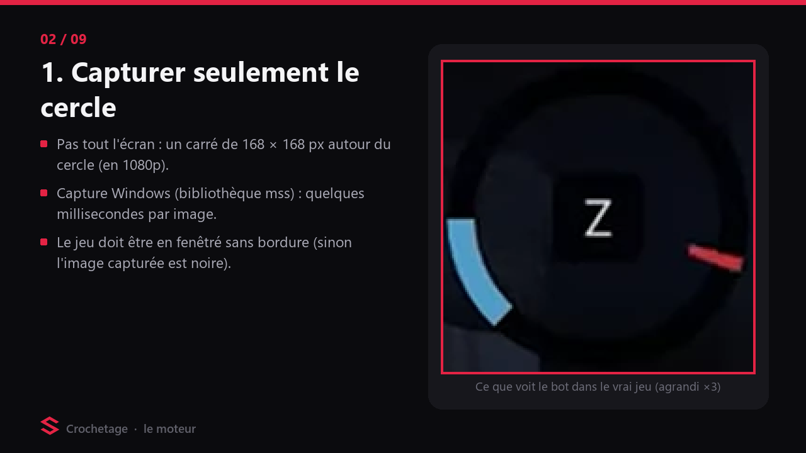
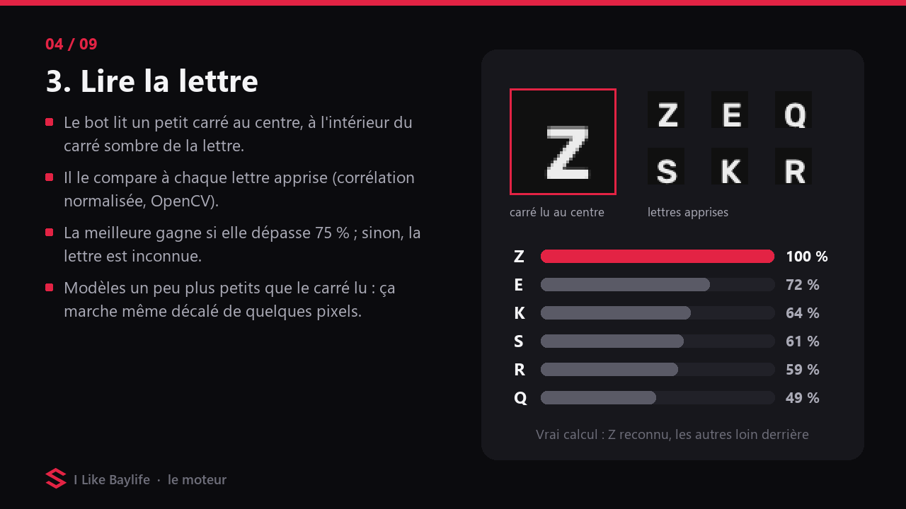
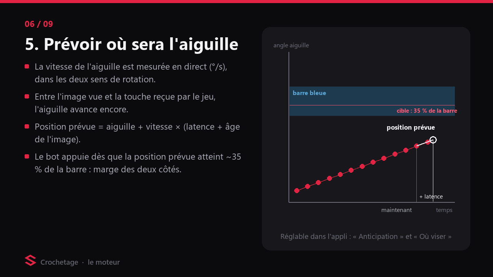
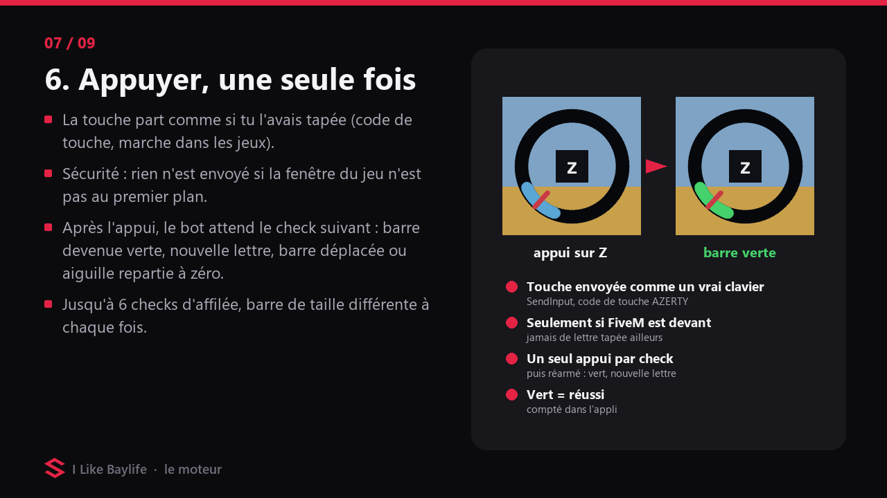
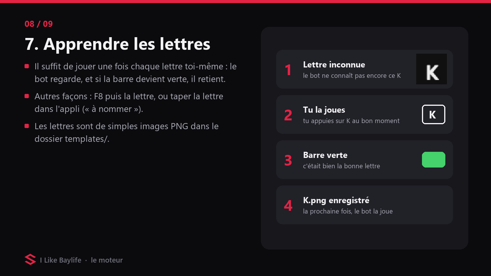
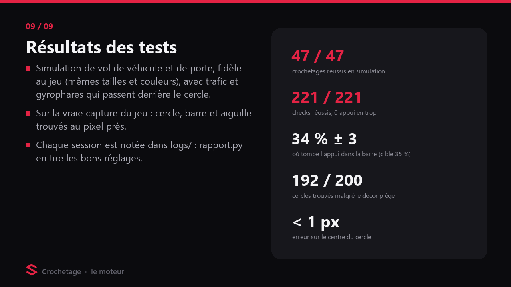
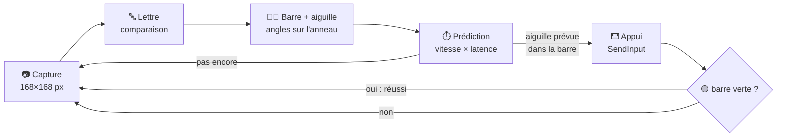
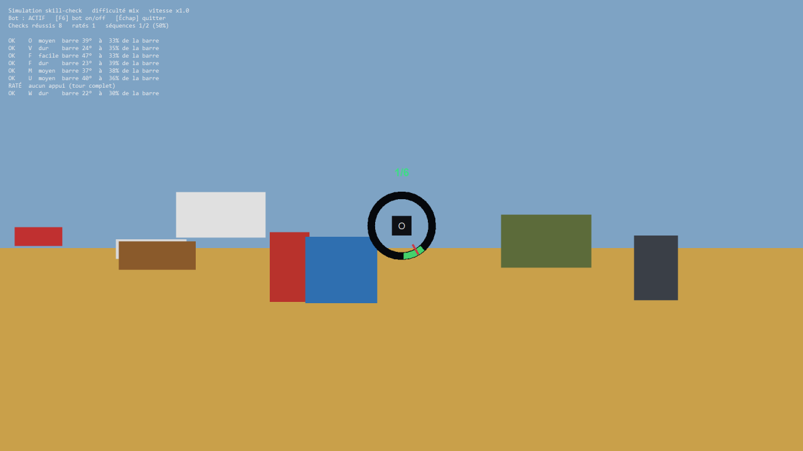

<p align="center">
  
</p>

<p align="center">
  
  
  
  
</p>

**I Like Baylife** joue tout seul le skill-check de FiveM. Un cercle apparaît au milieu de l'écran avec
une lettre au centre, une barre bleue et une aiguille rouge qui tourne. Dès que l'aiguille arrive dans la
barre, l'appli appuie sur la bonne lettre. Elle enchaîne jusqu'à 6 checks, avec une barre de taille
différente à chaque fois.

<table>
  <tr>
    <td align="center"><br><sub><b>Le bot en action</b> (ce qu'il voit, en vrai)</sub></td>
    <td align="center"><br><sub><b>L'appli</b>, près de l'horloge</sub></td>
  </tr>
</table>

> [!WARNING]
> Sur la plupart des serveurs FiveM, les macros et l'automatisation sont interdites par le règlement.
> À utiliser à tes risques (ban possible).

---

## Sommaire
- [Le moteur en diaporama](#-le-moteur-en-diaporama)
- [Comment ça marche, en détail](#-comment-ça-marche-en-détail)
- [Installation](#-installation)
- [Utilisation](#-utilisation)
- [La simulation](#-la-simulation)
- [Réglages et dépannage](#-réglages-et-dépannage)
- [Fichiers du projet](#-fichiers-du-projet)

---

## 🎬 Le moteur en diaporama

Le cœur du bot en 9 diapos (elles défilent toutes seules). Toutes les images viennent des **vrais calculs
du moteur**, faits sur une vraie capture du jeu et sur la simulation.

<p align="center">
  
</p>

<details>
<summary><b>▶ Voir les diapos une par une</b></summary>
<br>

| | |
|---|---|
|  |  |
|  |  |
|  |  |
|  |  |
|  | |

</details>

---

## 🧠 Comment ça marche, en détail

### La boucle



Tout se passe dans [`autotouche.py`](autotouche.py), dans la classe `Moteur`. La boucle tourne environ
150 fois par seconde : capture, lecture, décision, et appui si c'est le moment.

### 1. Trouver le cercle (touche F7)
Pas besoin de régler une zone à la souris. Pendant qu'un skill-check tourne, **F7** lance
`detecter_cercle_anime()` :
1. pendant ~1 s, le bot ne garde que le rouge **qui vient d'apparaître** (l'aiguille qui bouge) ;
2. à chaque image, l'aiguille devient un petit **trait qui pointe vers le centre** (axe principal du bloc
   de pixels, par ACP) ;
3. un **vote** (RANSAC) cherche le point où presque tous les traits se croisent : c'est le centre, à
   moins d'un pixel près. Les traits du décor (une voiture rouge qui passe) ne se croisent pas au même
   endroit : ils sont éliminés ;
4. l'épaisseur de l'anneau vient de la longueur de l'aiguille.

<p align="center">
  <br>
  <sub>Sur une vraie capture du jeu : anneau trouvé (vert), bords de la barre (jaune) et aiguille (rouge).</sub>
</p>

### 2. Lire la lettre
Un petit carré au centre (20 % de la zone, à l'intérieur du carré sombre) est comparé aux lettres
apprises avec `cv2.matchTemplate` (corrélation normalisée). La meilleure gagne si elle dépasse **75 %**.
Les modèles sont un peu plus petits que le carré lu, donc une lettre décalée de quelques pixels est
quand même reconnue.

### 3. La barre et l'aiguille
- Masques de couleur **HSV** (bleu = barre, rouge = aiguille, vert = réussi), **seulement sur l'anneau** :
  le décor visible au milieu du cercle (l'anneau est transparent) ne compte pas.
- Chaque pixel devient un **angle**, rangé par cases de 2°.
- **Barre** = le bloc bleu le plus *épais* (le plus de pixels par case) ; **aiguille** = le bloc rouge le
  plus épais. Un liseré de décor au bord de l'anneau ne fait que 1 ou 2 pixels de large, donc il est écarté.

### 4. Prévoir le bon moment
La vitesse de l'aiguille est mesurée en direct, dans les deux sens de rotation. Le bot calcule :

```
position prévue = aiguille + vitesse × (latence + âge de l'image)
```

Il appuie dès que la position prévue atteint **35 % de la barre** (réglable). Ça laisse de la marge
avant et après, même sur les petites barres. Si la vitesse n'est pas encore connue, il attend une
image de plus.

### 5. Appuyer, une seule fois
- La touche part avec `SendInput` en **code de touche** (scancode) : le jeu la reçoit comme une vraie
  frappe, et le clavier AZERTY est géré.
- **Sécurité** : rien n'est envoyé si la fenêtre au premier plan n'est pas « FiveM ». Le bot ne tape
  jamais de lettre dans une autre appli.
- Un **verrou** garantit un seul appui par check. Il se libère quand la barre devient verte, que la
  lettre change, que la barre bouge ou que l'aiguille repart de zéro.

### 6. Apprendre les lettres
- **Tout seul** : sur une lettre inconnue, tu la joues toi-même. Si la barre devient verte, le bot
  enregistre l'image comme modèle.
- Ou **F8** puis la lettre, ou bien en tapant la lettre dans l'appli (« à nommer »).

### Résultats des tests
| Test | Résultat |
|---|---|
| Simulation, bot complet (vraie capture d'écran, décor piège qui bouge) | **46 / 46** checks, **10 / 10** séquences |
| Détection du cercle sur 200 scènes générées (nuit, voitures bleues/rouges collées) | **192 / 200**, centre à < 1 px |
| Vraie capture du jeu | cercle, barre et aiguille trouvés au pixel près |
| Vraies touches clavier dans la simulation | **24 / 24** |

---

## 📦 Installation
1. Installer [Python 3.12+](https://www.python.org/downloads/) (cocher « Add Python to PATH »).
2. Télécharger ce dépôt (bouton **Code → Download ZIP**) et le décompresser.
3. Double-clic sur **`0_installer.bat`** (installe mss, OpenCV, numpy, pystray, Pillow).

## 🎮 Utilisation
1. Double-clic sur **`1_Lancer I Like Baylife.bat`** : le logo apparaît près de l'horloge (sinon,
   regarde dans la flèche `^`). Il est rouge quand le bot est actif, gris en pause.
2. Mets le jeu en **fenêtré sans bordure** (en plein écran exclusif, la capture d'écran sort noire).
3. Lance un skill-check, puis appuie sur **F7** pendant que l'aiguille tourne : « Cercle trouvé ».
4. Appuie sur **F6** pour activer ou mettre en pause.

| Touche | Action |
|---|---|
| **F6** | activer / pause |
| **F7** | trouver le cercle (pendant un skill-check) |
| **F8** | apprendre la lettre affichée (puis appuie sur la lettre) |

Clic sur le logo : ouvre l'appli (aperçu en direct de ce que voit le bot, état, réglages).
Clic droit : Activer, Détecter, Simulation, Quitter.

## 🧪 La simulation
**`2_Simulation.bat`** ouvre un skill-check d'entraînement en **plein écran sans bordure**, copié sur le
vrai (mêmes tailles et couleurs) : 3 à 6 checks d'affilée, barre de taille variable qui devient verte,
décor qui bouge derrière. Le bot de la simulation trouve le cercle et apprend les lettres tout seul.
**F6** = bot ON/OFF (pour jouer toi-même), **Échap** = quitter.

<p align="center"></p>

## 🔧 Réglages et dépannage


| Réglage (⚙) | Quand y toucher |
|---|---|
| **Anticipation** | Appuie trop **tard** dans la barre → monte. Trop **tôt** → baisse. |
| **Où viser** | 0 % = dès l'entrée de la barre, 50 % = au milieu. |
| **Reconnaissance** | Mauvaise lettre → monte. Lettre pas reconnue → baisse. |
| **Fenêtre du jeu** | Texte que doit contenir le titre de la fenêtre (par défaut « FiveM »). |
| **Démarrer avec Windows** | Lance l'appli à l'ouverture de session. |

- **« Cercle pas trouvé »** : refais F7 pendant que l'aiguille tourne.
- **« PAS envoyé : fenêtre active … »** : le jeu n'était pas devant, ou son titre ne contient pas
  « FiveM ». Corrige « Fenêtre du jeu ».
- **Touche ignorée par le jeu** : lance l'appli en administrateur.
- Journal complet : `ilikebaylife.log`.

<br clear="right">

## 📁 Fichiers du projet
| Fichier | Rôle |
|---|---|
| [`ILikeBaylife.pyw`](ILikeBaylife.pyw) | l'appli (zone de notification + fenêtre style Mullvad) |
| [`autotouche.py`](autotouche.py) | le moteur : détection, analyse, décision, clavier (utilisable aussi en ligne de commande) |
| [`simulation.py`](simulation.py) | la simulation d'entraînement |
| [`logo.png`](logo.png) | le logo (icône de l'appli) |
| `config.json`, `templates/` | créés au premier lancement : tes réglages et tes lettres apprises (non versionnés) |

En ligne de commande : `python autotouche.py --detecter`, `--debug`, ou `--test capture.png` pour tester
la détection sur une capture d'écran.

---

<p align="center">
  <sub>Du même auteur : <a href="https://github.com/vortexturize-ai/paperasse"><b>Paperasse</b></a>, tes papiers rangés et expliqués · <a href="https://github.com/vortexturize-ai">profil</a></sub>
</p>
